# Homepage redesign research: theodenanyoh.com

Date: 2026-11-15. Source: Mobbin site sections. Status: option 1 (Editorial bento) chosen and brand approved on 2026-11-15.

## Brief and decision status

- **Site:** theodenanyoh.com, a Payload CMS and Next.js personal site.
- **Audiences, in order:** employers hiring a product leader at a startup or small tech company; possible co-founders; possible clients.
- **Primary action:** watch the video resume, then get in touch.
- **Decided on 2026-11-15:** employers lead; the hiring signal stays quiet; hero copy 'A product leader who still ships.' on two lines at a reduced size; white ground with a cobalt accent and the 'Td.' mark; work shown as a bento; no metric strip; a logo marquee of employers and launched products; a content section for articles and videos; a shop section for templates, merch and consulting. The dark direction was rejected.
- **Chosen:** option 1, Editorial bento.

## Current-state audit

Based on the live HTML of `/`, `/about-me`, `/contact` and `/projects/krumalabs` fetched on 2026-11-15, and on the repository code. No rendered screenshots of the live site were captured, so visual claims about the current site are limited to structure and copy.

- The homepage is a stack of CMS blocks: hero, skills grid, three posts, four projects, a 'Coming Soon' shop block.
- No employer, role, or outcome appears on the homepage. 'My Resume' links to a PDF on Google Drive.
- The four projects shown (CreatorBox, Built In Africa, StyleBook HQ, KrumaLabs) all carry the same three technology tags. Cleanly, Tilly, DirectoryHub and the other live products are absent.
- There is no video anywhere on the site.
- The contact page and the About page both render 'Form not available.'
- Strength: the nav already has the right five destinations, and the 'Td.' logo is distinctive.

## Reference evidence

### Hero and video

**OpenSea** ([Mobbin](https://mobbin.com/sites/sections/3361ca06-fc0e-478a-ba20-7545fd461db6), `3361ca06-fc0e-478a-ba20-7545fd461db6`)

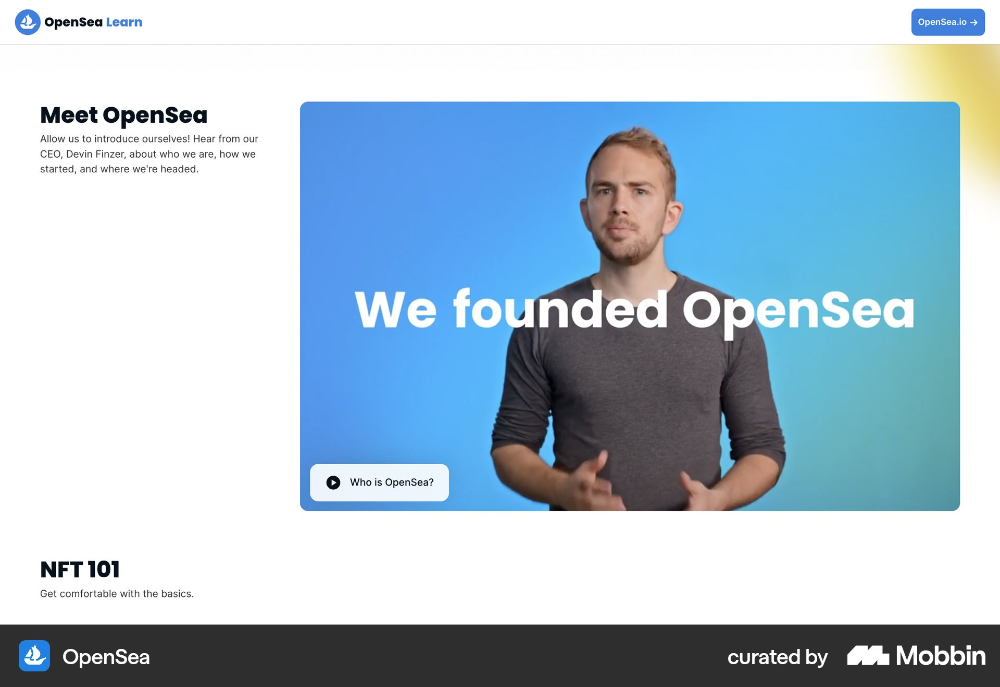

- Seen: Short text column on the left, one large rounded video frame on the right. The founder is on camera, a caption is burned into the frame, and a small pill in the corner names the video.
- Adapt: Keep the two-column hero. Put the video resume in a rounded frame with a labelled play pill ('Meet Theo, 1:30') in the bottom-left corner so the frame reads as a video before anyone clicks.
- Leave out: The frame takes 70% of the width and pushes the copy into a narrow strip. Theo's headline needs more room than that.
- Query: "personal portfolio hero section with video intro"

**ClickUp** ([Mobbin](https://mobbin.com/sites/sections/22e47073-e617-48c3-8d2b-826872236efc), `22e47073-e617-48c3-8d2b-826872236efc`)

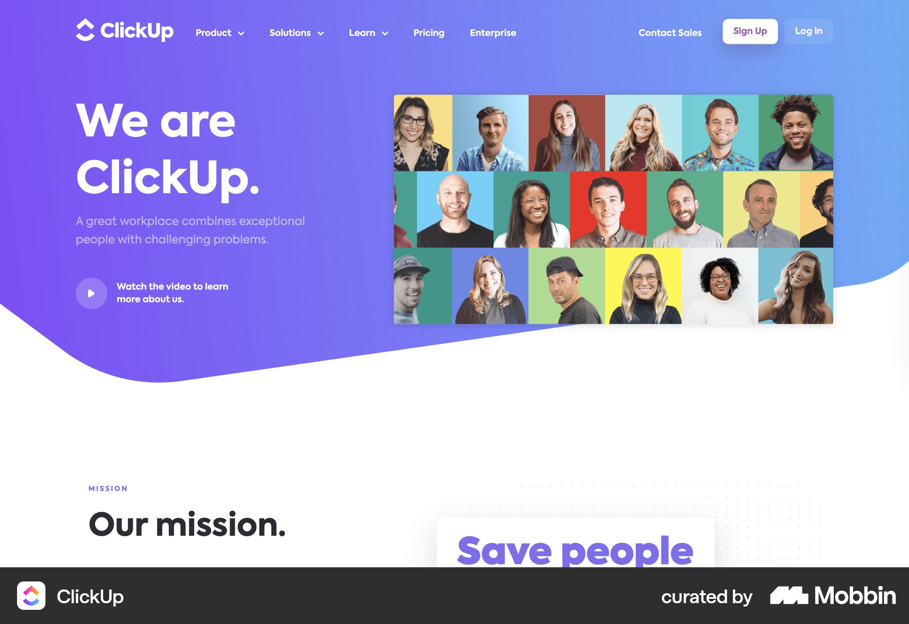

- Seen: Two-line headline that ends in a full stop, a one-sentence subhead, and a round play button with a text label beside it. The media block sits to the right.
- Adapt: Confirms the two-line headline at a moderate size and a play control that is a button plus words, which is easier to hit and to understand than an icon alone.
- Leave out: The purple gradient wave and the face mosaic. Both date the page.
- Query: "personal portfolio hero section with video intro"

**Kalstore** ([Mobbin](https://mobbin.com/sites/sections/5e1e6047-eef1-417c-b42b-c7ab44205e35), `5e1e6047-eef1-417c-b42b-c7ab44205e35`)

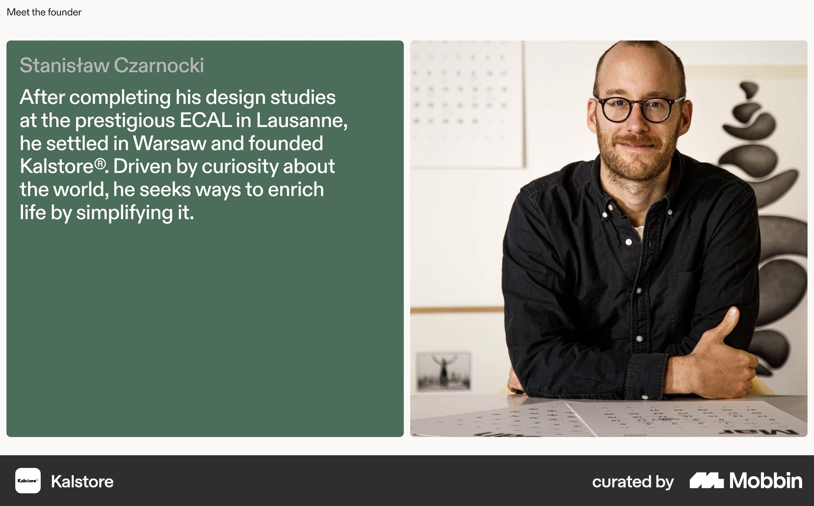

- Seen: Two equal tiles side by side: a flat colour tile carrying a short founder bio in large type, and a portrait photo. Both have the same radius and height.
- Adapt: Use for the About teaser lower on the page: a cobalt tile with three sentences beside a portrait. It also shows a portrait works at full tile height without decoration.
- Leave out: The bio is written in the third person. Theo's site speaks in the first person.
- Query: "founder personal website hero with portrait photo and short bio"

**GitHub ReadME** ([Mobbin](https://mobbin.com/sites/sections/10928b8e-852d-4424-b248-8028e8ff92d5), `10928b8e-852d-4424-b248-8028e8ff92d5`)

- Seen: Condensed heavy headline, a small mono caps line under it, then a plain first-person paragraph with a slim facts column on the right (location, link).
- Adapt: Supports a small caps role line above the headline and a facts column (Columbus, Ohio; current role; studio) beside the hero paragraph.
- Leave out: Centred headline. Theo's hero is left-aligned.
- Query: "founder personal website hero with portrait photo and short bio"

### Work grid

**Instrument** ([Mobbin](https://mobbin.com/sites/sections/05811dd7-a07a-41ae-9fa7-192b8eede1b1), `05811dd7-a07a-41ae-9fa7-192b8eede1b1`)

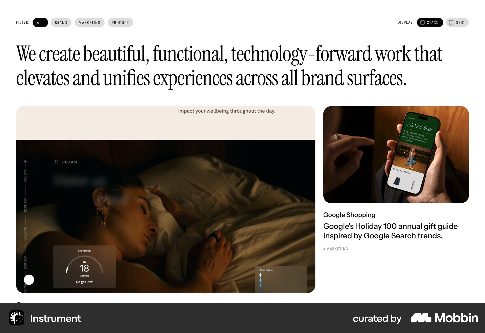

- Seen: A large tile about two thirds wide beside a narrower tile. Images fill the tiles edge to edge with a 16 to 20px radius, and the client name and one-line description sit under the image, not on top of it. Filter chips sit above the grid.
- Adapt: This is the bento rhythm to use: one wide tile and one narrow tile per row, captions under the image. Add filter chips (All, Live, In build) above the bento.
- Leave out: The serif display type. It conflicts with the Inter Tight brand.
- Query: "agency selected work case studies section"

**Framer** ([Mobbin](https://mobbin.com/sites/sections/3bff67c0-a4b7-49bf-9a6c-efd3b6dec507), `3bff67c0-a4b7-49bf-9a6c-efd3b6dec507`)

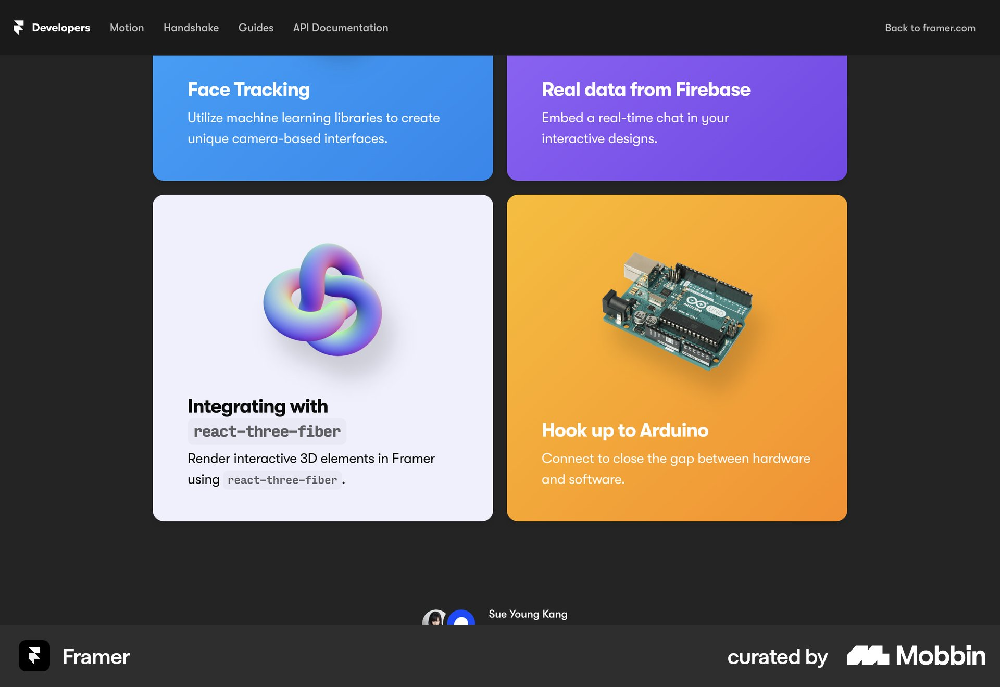

- Seen: Tiles in saturated flat colours (blue, violet, orange, pale grey) with the title and two lines of copy at the bottom-left and an object floating in the upper half.
- Adapt: Basis for the 'Poster' option: each product tile takes that product's own brand colour, with the product name at the bottom-left and a device shot in the upper half.
- Leave out: Gradients inside the tiles. Flat colour reads cleaner next to cobalt.
- Query: "features bento grid with cards of different sizes"

**Loom** ([Mobbin](https://mobbin.com/sites/sections/4470dfca-a7ae-4a96-a9b4-a33395edbd07), `4470dfca-a7ae-4a96-a9b4-a33395edbd07`)

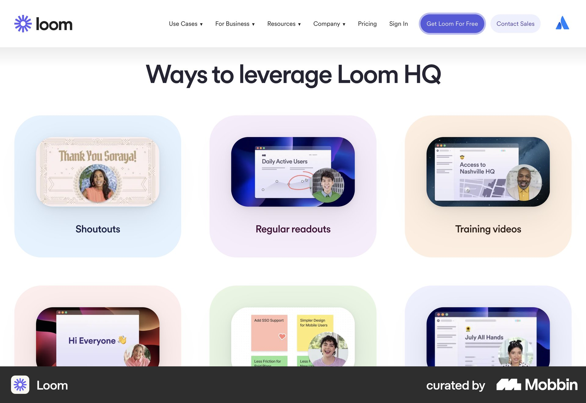

- Seen: Tiles with a very large radius in pale tints (blue, lilac, peach, mint). A product screenshot sits inside each tile on its own rounded card and a one-word label sits below it.
- Adapt: Basis for the 'Editorial bento' option: pale tint per product, real screenshot inset on a card, name and one line below. Pale tints keep cobalt as the only loud colour.
- Leave out: Every tile is the same size. A bento needs at least one double-width tile.
- Query: "features bento grid with cards of different sizes"

**Analogue Agency** ([Mobbin](https://mobbin.com/sites/sections/8e1d64b0-7c88-4989-b510-515186fc2b75), `8e1d64b0-7c88-4989-b510-515186fc2b75`)

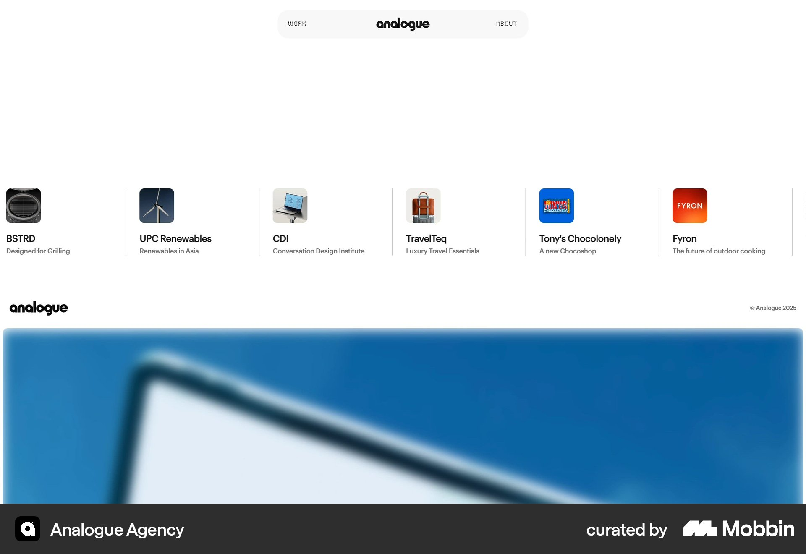

- Seen: A horizontal row of projects, each shown as a small app-icon square with the name and a four-word descriptor under it, separated by thin vertical rules.
- Adapt: Use for the 'products I have launched' half of the marquee: app icon, name, four-word descriptor. Theo's products already have app icons, so this needs no new artwork.
- Leave out: The floating centred nav pill.
- Query: "agency selected work case studies section"

**COLLINS** ([Mobbin](https://mobbin.com/sites/sections/ff78358e-49d9-4e34-bb81-4193ca3a6cc3), `ff78358e-49d9-4e34-bb81-4193ca3a6cc3`)

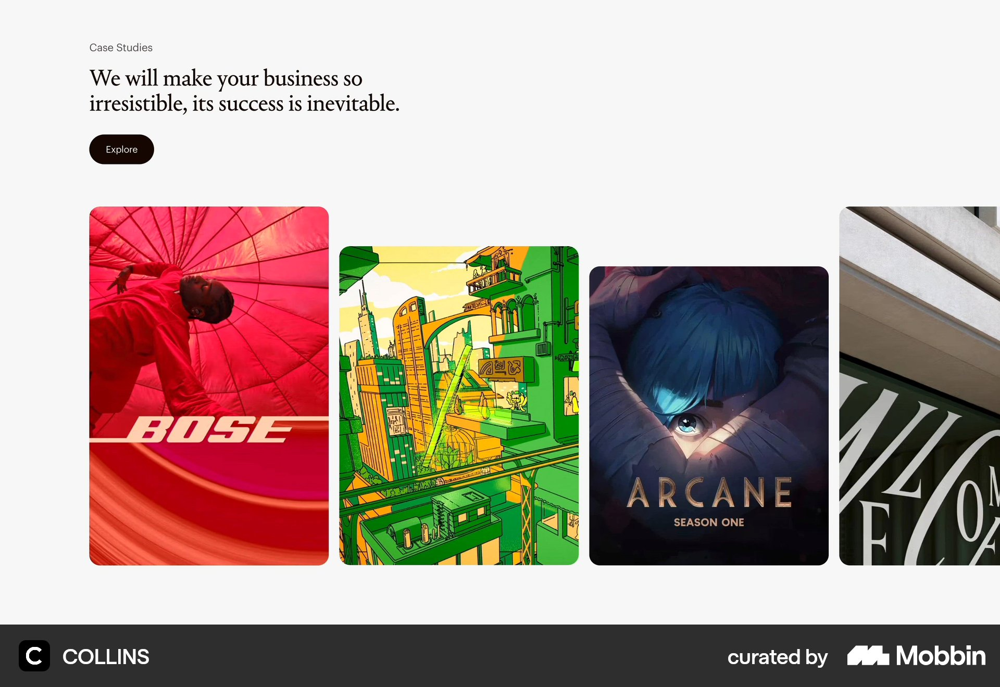

- Seen: A short intro and button on the left, then tall portrait cards that run off the right edge of the page to signal a horizontal scroll.
- Adapt: Alternative to the bento for phones: the same tiles become a horizontal swipe row that bleeds off the right edge.
- Leave out: Tall poster crops. Product screenshots are landscape or phone-shaped and would be cut badly.
- Query: "agency selected work case studies section"

### Logo strip

**Attio** ([Mobbin](https://mobbin.com/sites/sections/be4d8246-c2b7-4e06-b89d-501bb9fa4340), `be4d8246-c2b7-4e06-b89d-501bb9fa4340`)

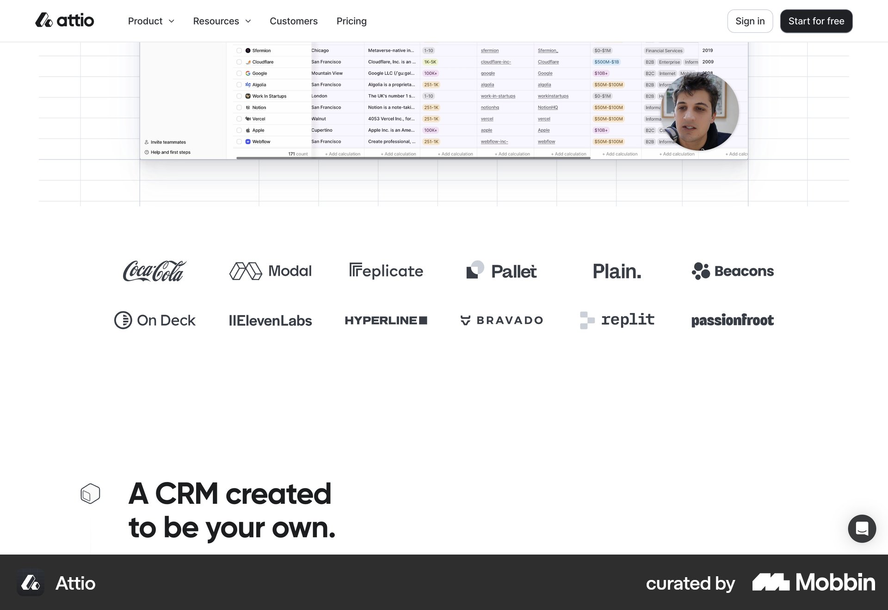

- Seen: Twelve logos in two rows of six, all in solid black, evenly spaced, with no heading and generous space above and below.
- Adapt: All logos in one ink colour at one optical height. Two rows also works as the reduced-motion fallback for the marquee.
- Leave out: No label at all. Theo's strip mixes employers and his own products, so it needs a label for each group.
- Query: "logo marquee section of companies"

**Lattice** ([Mobbin](https://mobbin.com/sites/sections/a92a8f7d-1c37-4ae6-abc1-00eab8edc50e), `a92a8f7d-1c37-4ae6-abc1-00eab8edc50e`)

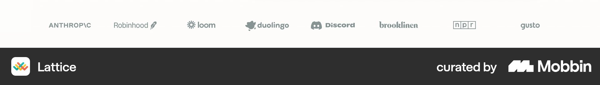

- Seen: One row of eight logos in a muted grey on white. The strip is thin and quiet.
- Adapt: Grey logos at rest that turn ink on hover keep the strip from competing with the hero.
- Leave out: Nothing. This is the closest match.
- Query: "logo marquee section of companies"

**Givingli** ([Mobbin](https://mobbin.com/sites/sections/c12c53bc-7559-4071-a051-ae1ef2f9a8a7), `c12c53bc-7559-4071-a051-ae1ef2f9a8a7`)

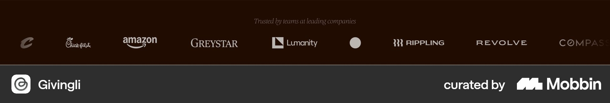

- Seen: A small centred caption above a single row of logos that is cut off at both edges, which shows the row is moving.
- Adapt: Let the row run off both edges and put a small caption above it. Fade the edges so the cut looks deliberate.
- Leave out: The dark brown ground.
- Query: "logo marquee section of companies"

### Content

**Going** ([Mobbin](https://mobbin.com/sites/sections/d5922e7b-ef05-4512-ab67-77774360b335), `d5922e7b-ef05-4512-ab67-77774360b335`)

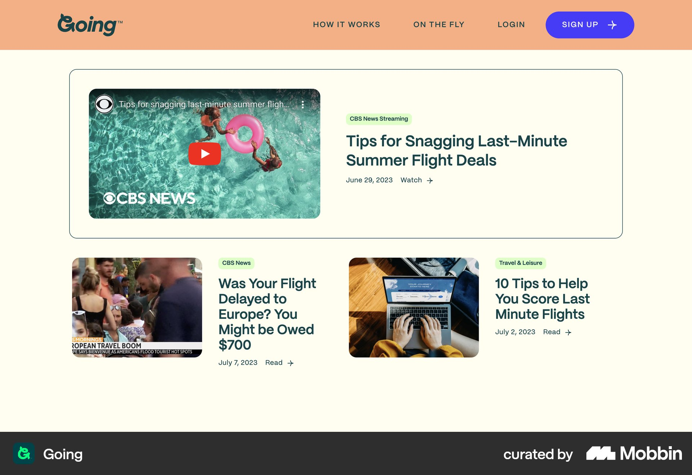

- Seen: One wide featured card with a video thumbnail on the left and the title, date and a 'Watch' link on the right. Two smaller cards below pair a thumbnail with a title and a 'Read' link. A small tag sits above each title.
- Adapt: Use this structure directly: the newest video gets the wide card, the two newest articles sit below. The verb in the link ('Watch', 'Read') tells the visitor the format.
- Leave out: The outlined border on the featured card and the peach header.
- Query: "articles and videos content section"

**ClickUp** ([Mobbin](https://mobbin.com/sites/sections/cb6028d0-a6a2-4cd6-8a2b-ce788fc7b67f), `cb6028d0-a6a2-4cd6-8a2b-ce788fc7b67f`)

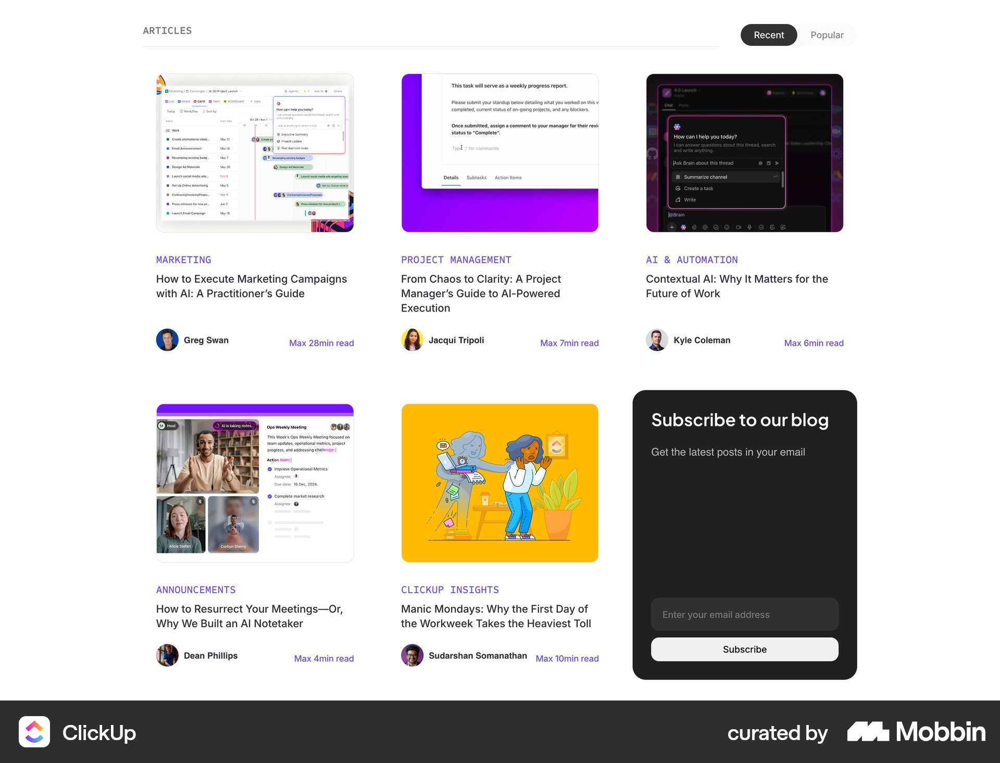

- Seen: Three-column article grid with a cover image, a mono caps category in the accent colour, the title, then author and reading time. A dark subscribe tile takes one grid slot.
- Adapt: Category in cobalt caps above each title and reading time under it. One grid slot can hold a newsletter or 'follow on LinkedIn' tile.
- Leave out: Author avatars. Every post is by Theo.
- Query: "articles and videos content section"

### Shop

**Teachable** ([Mobbin](https://mobbin.com/sites/sections/fdf9f7c7-623a-4ff0-b0d2-14c125bf0574), `fdf9f7c7-623a-4ff0-b0d2-14c125bf0574`)

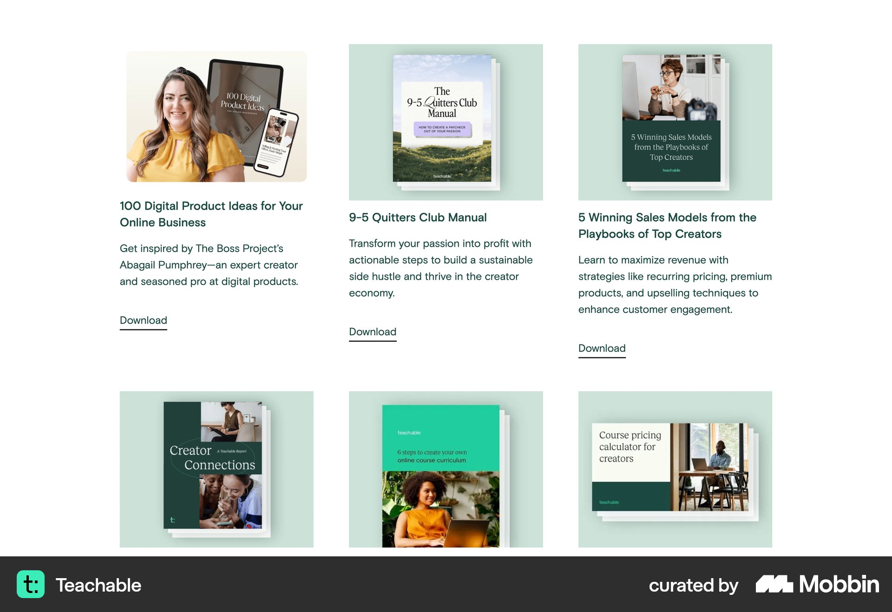

- Seen: Three columns. Each product is a cover mock-up on a pale tinted square, then a title, two lines of description and an underlined text link.
- Adapt: Use for templates and merch: cover on a tinted square, title, one line, price, underlined link. Consulting gets a wider tile because it is a service, not a download.
- Leave out: No prices are shown. Theo's shop should show a price or 'Free'.
- Query: "creator shop section selling templates and digital products"

**Whop** ([Mobbin](https://mobbin.com/sites/sections/b75b3388-6586-4abf-9a29-1f3d31853973), `b75b3388-6586-4abf-9a29-1f3d31853973`)

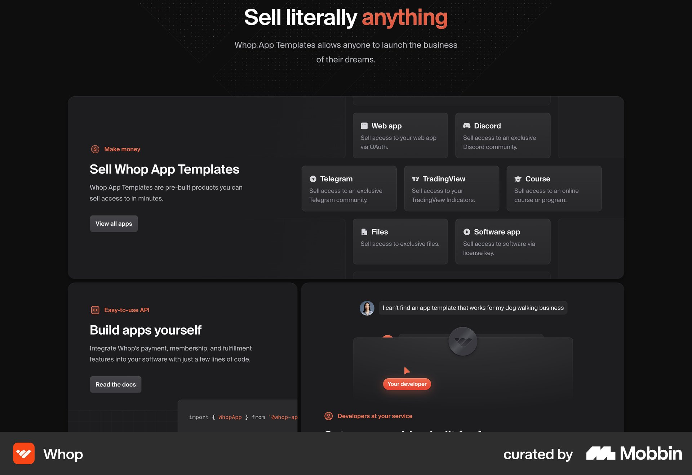

- Seen: A dark bento: one full-width tile on top and two half-width tiles below, each with a small coloured label, a heading, two lines and a button.
- Adapt: The one-wide-plus-two-half layout suits a three-item shop (consulting wide, templates and merch below).
- Leave out: The dark theme. Theo rejected the dark direction on 2026-11-15.
- Query: "creator shop section selling templates and digital products"

## Extracted rules

| Element | Rule | Supported by | Status |
|---|---|---|---|
| Headline | Inter Tight 800, 84px on desktop, two lines, ends in a cobalt full stop. | ClickUp, GitHub ReadME | Observed two-line headlines at moderate size; the size value is my call. |
| Role line | 14px caps, 0.08em tracking, cobalt, above the headline. | GitHub ReadME, ClickUp blog | Observed. |
| Video frame | Rounded frame, labelled play pill in the bottom-left corner, caption burned into the poster. | OpenSea | Observed. Autoplay and captions are not verified from a still. |
| Tile radius | 24px on bento tiles, 12px on inset screenshots. | Loom, Instrument | Inferred from the stills. |
| Tile caption | Product name and one line sit under the image, not over it. | Instrument, Fiasco | Observed. |
| Grid rhythm | Every bento row holds one double tile and one single, or three singles. No row repeats the row above. | Instrument, Whop | Interpretation. |
| Logo strip | One colour, one optical height, grey at rest. Row runs off both edges. | Lattice, Attio, Givingli | Observed. Motion is not verified from a still. |
| Link verb | Content links say 'Watch' or 'Read'. Shop links say the price. | Going, Teachable | Observed for content; price is my addition. |

## Three layout and styling options

These are proposals, not built screens.

### Option 1: Editorial bento (recommended)

White page, ink type, cobalt as the only loud colour. Product tiles in pale tints with real screenshots inset.

| Section | Treatment | Drawn from |
|---|---|---|
| Hero | Two-line headline at 84px, left. Video resume in a 4:5 rounded frame on the right with a labelled play pill. | OpenSea, ClickUp |
| Logo strip | One moving row. Employers as grey wordmarks, then products as app icon plus name. Edges fade. | Lattice, Givingli, Analogue |
| Work | Bento on a 3-column grid. Row 1: Cleanly double-width, Tilly single. Later rows mix singles and one more double. Pale tint per product, 24px radius, caption under the screenshot. Filter chips above. | Instrument, Loom |
| Content | One wide video card, two article cards under it, cobalt caps category. | Going, ClickUp blog |
| Shop | Consulting as a wide tile, templates and merch as two half tiles, each with a price. | Whop layout, Teachable cards |

- For: Closest to what you already approved. Screenshots carry the colour, so the page stays calm and the cobalt dot still stands out.
- Against: Pale tints can look generic if the screenshots are weak. It depends on good captures of each product.

### Option 2: Studio index

Off-white page, larger images, almost no tinted surfaces. The work reads like a studio's case-study index.

| Section | Treatment | Drawn from |
|---|---|---|
| Hero | Same two-line headline. The video frame is wider (16:10) and sits under the copy at full width. | Instrument, OpenSea |
| Logo strip | Static two rows of ink logos, no motion. | Attio |
| Work | Asymmetric rows: one tile two thirds wide beside one tile one third wide, alternating sides. Image fills the tile, name and one line sit under it. | Instrument, Fiasco |
| Content | Three-column grid, cover image on top, one slot holds a subscribe tile. | ClickUp blog |
| Shop | Three equal cover cards with underlined links. | Teachable |

- For: Gives the products the most room and looks the most senior. Best if you want employers to read you as a studio head.
- Against: Needs strong wide imagery for every product. The full-width video pushes the logo strip and work below the first screen.

### Option 3: Poster

White page, but every bento tile is a block of solid colour: cobalt, gold, ink, and each product's own brand colour.

| Section | Treatment | Drawn from |
|---|---|---|
| Hero | Same two-line headline. The video frame sits on a solid cobalt tile. | Kalstore, ClickUp |
| Logo strip | Ink wordmarks separated by cobalt dots, moving. | Givingli |
| Work | Bento of saturated tiles. Product name large at the bottom-left in white, device shot in the upper half. | Framer |
| Content | Wide video card on an ink tile, article cards on white. | Going |
| Shop | Three colour tiles: gold for merch, cobalt for consulting, ink for templates. | Whop layout |

- For: The most memorable and the most 'founder'. Works even when a product has no good screenshot yet.
- Against: Many loud colours compete with the cobalt dot, and it can read as less serious to an employer.

## Prioritised changes

1. **Hero.** Two-line headline at 84px, video frame with a labelled play pill. Needs: a portrait or video poster. Accept when the headline holds two lines at 1440, 1024 and 390 wide.
2. **Logo strip.** Needs: permission-safe logo files for Paycor, Paychex and Morgan Stanley, and app icons for each product. Accept when all marks share one colour and height and the strip has a static fallback for reduced motion.
3. **Work bento.** Needs: one good screenshot per product; demo data only for marsHedge. Accept when no two adjacent rows share a layout and every tile links to a project page.
4. **Content section.** Needs: at least one published video. Until then the wide card holds the newest article.
5. **Shop section.** Needs: real prices and destinations for templates, merch and consulting.
6. **Contact.** Fix 'Form not available.' before launch; every route ends there.

## Coverage limits

- Sixteen sections kept from eight section searches of five or six results each. This is a sample, not a survey of the library.
- Five results returned a blank frame and were not used.
- The 'bento grid presenting products or projects' query returned no true bento. The second query, 'features bento grid with cards of different sizes', returned feature grids, which are analogies for a project bento.
- No personal website of an individual product leader appeared in the results. Hero references are company and agency pages.
- All references are still images. Motion, hover and video behaviour were not observed.
- Image files were downloaded successfully. The canonical Mobbin links were not opened to verify them.

Blank previews, not used: [Metalab](https://mobbin.com/sites/sections/3e24cd34-ebbc-457e-84c6-33f869130747), [Buro](https://mobbin.com/sites/sections/6a6fe0b5-88df-4114-b06a-7647bc81a445), [Vucko](https://mobbin.com/sites/sections/03cfd319-c1ea-4020-91e8-07809a9ff0d2), [OFF+BRAND](https://mobbin.com/sites/sections/851e3996-4679-4653-aae6-3b345cab2aba), [Palmer Dinnerware](https://mobbin.com/sites/sections/fc9350ab-c91b-40c0-aa6d-3f05444217cd).

These references support design hypotheses. They are not evidence that any layout converts better.

## Review and decision log

| Date | Decision |
|---|---|
| 2026-11-15 | Employers lead; quiet hiring signal; Payload 3.93 now and v4 when stable. |
| 2026-11-15 | Directions A and B both declined. Kept: A's hero copy and hero layout. Added: brand, bento, logo marquee, content section, shop section. Removed: metric strip. |
| 2026-11-15 | Hero headline to two lines at a smaller size. Research requested. |
| 2026-11-15 | Theo chose option 1, Editorial bento, and approved the brand board (Td. mark, cobalt and Kente Gold, Inter Tight). |
